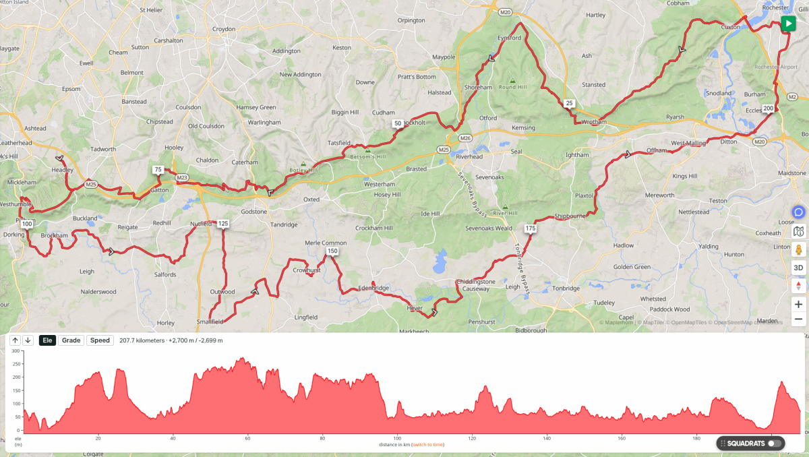
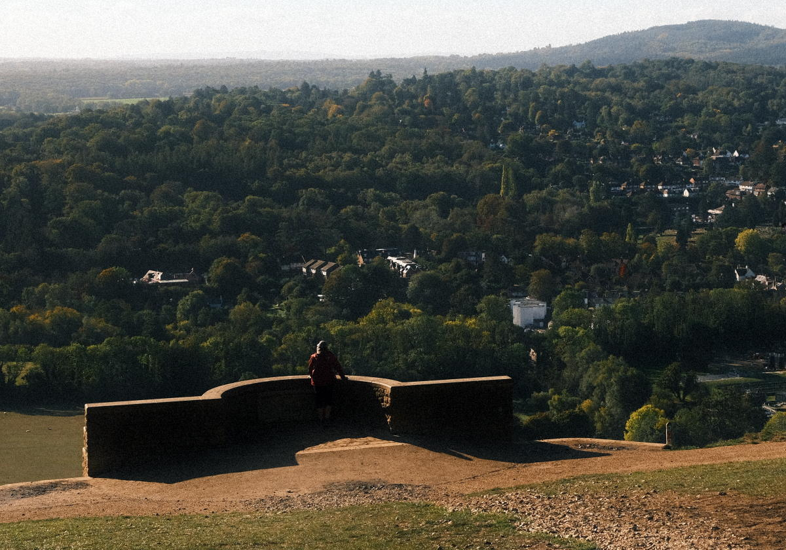
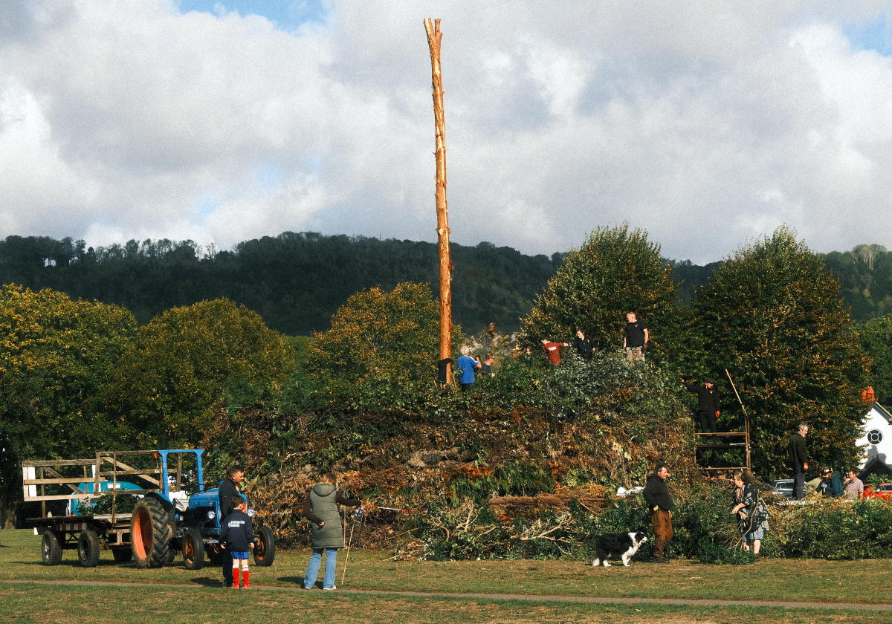
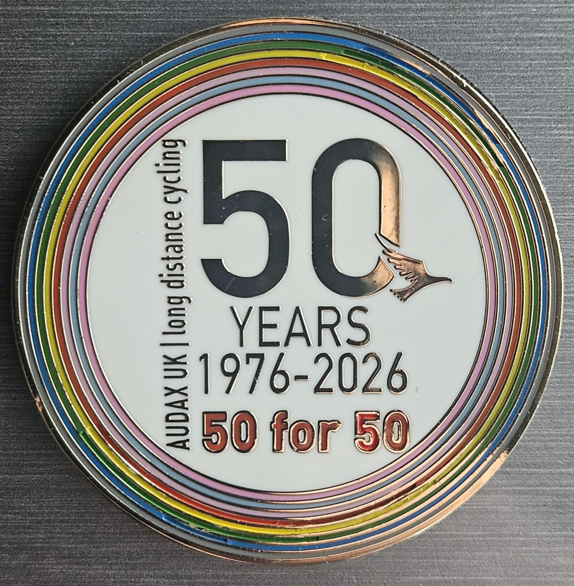
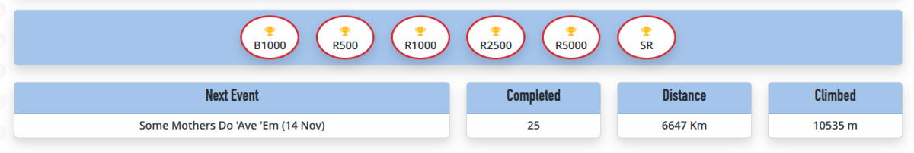
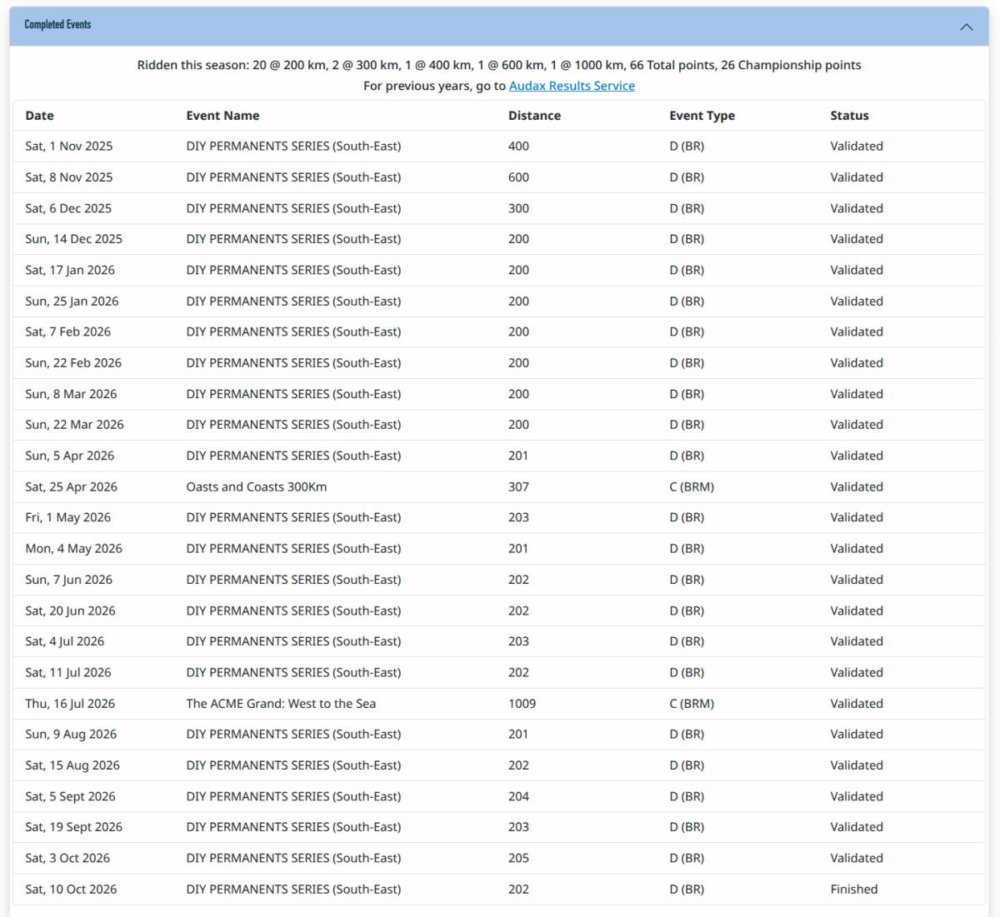

+++
title = "audax: West then East - North Downs 200 DiY"
description = "With an End of Season Summary"
date = 2026-10-14
tags = ["cycling"]
+++

Spouse was away. The boys are happy doing their own thing. That means I could be out again at the weekend for another 200. The 2025 - 2026 audax season ends in October so most likely this will was the last long ride I do until November. 

| Distance | Elevation Gain | Max Grade | Moving Time | Elevation Loss | Min Grade |
| -------- | -------- | -------- | -------- | -------- | -------- |
| 207.7 km     | 2,700 m     | 21.7%     | 10:06 hr     | 2,699 m    | -18.7 %     |

It was another great route. Second time I have done it. Hills and hedgerows on the way out offer protection against the wind. A couple of short sections of gravely byways followed some distance later with a path through Banstead golf course. A ride up from the gentler side to the summit of Box Hill then coasting down Zig Zag Road past roadies pushing for a personal best going up the other way. 

Prevailing westerlies mostly from behind on the way back. The sun was shining. Fluffy white clouds. Quiet roads. Lovely. 

Spring and Autumn often confound my choice of clothing. Got it just right this time. Never cold and not too hot. 

A food stop planned in every 50 km or so. That worked out well. Brockham Green is a great place to lunch. A well stocked village store. Park benches to sit down on. Quite often some kind of activity taking place on the green to look at while eating. 

On the way back I took a bit of detour to Nutfield to bag some tiles to help grow my largest square. Just a few more in that vicinity and I'll extend it from 26 to 28. No idea what I'm talking about? See [Explorer Tiles](https://blog.veloviewer.com/veloviewer-explorer-overview/) or [Squadrats](https://squadrats.com/rules) for context. 

The side wall on my back tyre failed as I was cycling out from Nutfield. Changed the tube and booted the tyre with a couple of emergency tenners I carry in my phone case. The nearest bike shop was just 4km away in Redhill. As luck would have it, mostly down hill all the way. Hat tip to [C&N Cycles](https://www.candncycles.co.uk). Friendly and helpful. New tyre fitted, back up the hill and on my way again. If not for the detour I would have been a lot further from a bike shop and in all probability had quite a long walk.  

It's been a good audax season. I set out to get at least 50 points to earn the  50th Anniversary Commemorative Medal (fridge magnet). 

I got that and ended up finishing with 66 points in total and another two RRtY series completed. Well happy. 

